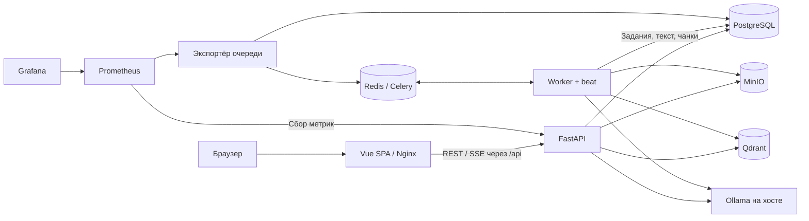

# Enterprise RAG Platform

Локальная платформа для поиска по документам и ответов на вопросы с указанием источников. Пользователь загружает документ, фоновый обработчик извлекает текст и строит индекс, а RAG-пайплайн находит доступные пользователю фрагменты и передаёт их локальной языковой модели.

Это учебный и портфолио-проект: он демонстрирует асинхронный Python, модульную архитектуру, обработку фоновых заданий, разграничение доступа и наблюдаемость. Коммерческое использование, качество ответов и прирост от отдельных методов поиска не заявляются как подтверждённые результаты.

## Возможности и текущие границы

| Область | Что реализовано |
| --- | --- |
| Документы | Загрузка PDF, DOCX, UTF-8 HTML и изображений PNG/JPEG до 10 MiB на файл; пакетная загрузка, контроль повторов, хранение оригиналов и метаданных. |
| Индексация | Для PDF и PNG/JPEG: извлечение текста и OCR (Tesseract, русский/английский) → чанки по страницам → локальные эмбеддинги → PostgreSQL и Qdrant; очередь, повторы и переиндексация. DOCX/HTML пока только сохраняются. |
| Поиск | Ключевой поиск PostgreSQL FTS, векторный поиск Qdrant и гибридный поиск с Reciprocal Rank Fusion (RRF). |
| Ответы | Локальная генерация с цитатами, явный отказ при недостатке данных или некорректных цитатах, опциональные переформулировка вопроса и LLM-переранжирование. |
| Доступ | JWT, роли admin/manager/member, семейные области доступа, видимость private/family, серверная проверка прав на документы. |
| Web Admin | Состояние сервисов, семьи и пользователи, документы, RAG Playground, редактирование системного промпта. Playground показывает источники, оценки поиска, время этапов, токены LLM и trace ID; SSE передаёт прогресс. |
| Наблюдаемость | Структурированные JSON-логи, метрики Prometheus, готовые дашборды Grafana для очереди и RAG. |

LangGraph-агенты, Langfuse, версионированный golden dataset и сравнительные эксперименты качества остаются следующими этапами. Наличие гибридного поиска и переранжирования само по себе не доказывает улучшение качества.

В [мобильном клиенте](mobile/README.md) первый экран позволяет указать и сохранить
адрес API компьютера в Wi-Fi сети, проверить соединение и перейти ко входу.
Доступны выбор семьи, документы и загрузка
PNG/JPEG с камеры или из файлов. Снимок отправляется серверу для Tesseract OCR и
индексации; перед отправкой показывается превью. Поддерживается только Android;
генерация и сборка для iOS не входят в проект. Настройка Android, API-адреса
и проверки описаны отдельно в README клиента.
Как применить изменения интерфейса, пересобрать APK и подключить телефон по Wi-Fi
или USB: [пересборка мобильного приложения](mobile/README.md#пересборка-после-правок).

## Запуск

### Требования

Нужны Docker Engine с Compose v2 и **Ollama на хосте**. Python и Node.js на хосте не требуются; команды `make` — сокращения для Docker-команд из [Makefile](Makefile).

Ориентир для локальной машины — 16 GB RAM, из них не менее 10 GB доступно Docker, и 20 GB свободного диска. Это рекомендация для начала работы, а не измеренный минимум: модели, документы и индексы требуют дополнительного места. Первые сборки и загрузки моделей требуют сети. CPU-режим поддерживается; ускорение GPU/Metal определяется установкой Ollama на хосте.

Все прикладные сервисы запускаются через [docker-compose.yaml](docker-compose.yaml). Исключение для Ollama зафиксировано в [ADR 0002](docs/adr/0002-host-ollama.md): Compose не запускает и не управляет сервером моделей.

### 1. Подготовить модели

Запустите приложение Ollama либо `ollama serve`, если сервер ещё не работает. В другом терминале выполните:

```sh
ollama pull embeddinggemma:latest
ollama pull qwen3:4b
ollama list
curl -fsS http://localhost:11434/api/tags
```

Модель эмбеддингов по умолчанию — `embeddinggemma:latest`, размерность — **768**; модель ответов — `qwen3:4b`. `make models` только выводит установленные модели и ничего не скачивает.

### 2. Настроить окружение

```sh
cp -n .env.example .env
```

Заполните `.env` собственными значениями:

| Переменная | Назначение |
| --- | --- |
| `POSTGRES_PASSWORD` | Пароль PostgreSQL; используйте URL-безопасные символы. |
| `MINIO_ROOT_USER`, `MINIO_ROOT_PASSWORD` | Локальные учётные данные MinIO; пароль не короче 8 символов. |
| `ADMIN_USERNAME`, `ADMIN_PASSWORD` | Начальный администратор: имя из 3–100 строчных ASCII-букв, цифр и символов `_.@-`; пароль 12–128 символов. |
| `JWT_SECRET` | Отдельный случайный ключ подписи длиной не менее 32 символов. |
| `OLLAMA_URL` | Адрес Ollama для контейнеров; по умолчанию `http://host.docker.internal:11434`. |

Общих паролей по умолчанию нет. `.env` исключён из Git. Остальные параметры описаны в [.env.example](.env.example).

### 3. Собрать и запустить

```sh
docker compose config --quiet
docker compose up -d --build
make bootstrap-admin
docker compose ps
make smoke
```

Compose автоматически находит `docker-compose.yaml`. Сервис `migrate` применяет Alembic-миграции перед запуском API и worker, затем завершается с кодом 0 — это ожидаемое поведение. `make bootstrap-admin` создаёт пользователя из `.env`, но не сбрасывает пароль уже существующей записи.

Зависимости зафиксированы в `uv.lock` и `web-admin/package-lock.json`. Для обычного запуска пересоздавать их не нужно. `make lock` предназначен для обновления lock-файлов с последующей проверкой изменений.

MinIO собирается из исходников через [infra/minio/Dockerfile](infra/minio/Dockerfile); первая сборка может занять несколько минут. Обоснование и ограничения выбранной версии — в [ADR 0003](docs/adr/0003-minio-source-build.md).

| Сервис | Адрес |
| --- | --- |
| Web Admin | http://localhost:3000 |
| FastAPI / OpenAPI | http://localhost:8000/docs |
| MinIO Console | http://localhost:9001 |
| Grafana, после включения monitoring | http://localhost:3001 |

Браузер обращается к API через Nginx-прокси `/api`. Порт Web Admin `3000` доступен в локальной сети (настраивается через `WEB_BIND_ADDRESS`, по умолчанию `0.0.0.0`); остальные опубликованные порты привязаны к `127.0.0.1`; PostgreSQL, Redis, Qdrant и S3 API MinIO доступны внутри Compose. Данные хранятся в именованных томах. `docker compose down` останавливает стек с сохранением данных.

Для мобильного клиента используйте `http://IP-компьютера:3000/api`, для проверки
backend — `curl -i http://IP-компьютера:3000/api/health`. Запрос к одному `/api`
возвращает редирект на `/api/`; это префикс маршрутов, а не health endpoint.
Nginx использует относительный `Location: /api/`, сохраняя внешний порт `3000`.
После изменения `web-admin/nginx.conf` примените конфигурацию командой
`docker compose up -d --build --no-deps web-admin`.

### 4. Пройти основной сценарий

1. Войдите в Web Admin с `ADMIN_USERNAME` и `ADMIN_PASSWORD`.
2. Создайте семью; при необходимости добавьте участников и связанные учётные записи.
3. На странице **Документы** загрузите PDF или изображение PNG/JPEG и выберите видимость `private` или `family`.
4. Обновляйте список до завершения обработки. Проверьте состояние индекса и откройте извлечённый текст. Ошибку можно диагностировать и повторить обработку через переиндексацию.
5. Откройте **RAG Playground**, выберите семью, режим поиска и задайте вопрос по документу.
6. Сравните «Только поиск» и «Получить ответ», проверьте цитаты, фрагменты, длительности и расход токенов. Оригинал можно скачать из карточки источника после проверки доступа сервером.

Playground выбирает `hybrid` по умолчанию; API без явного `retrieval_mode` использует `vector`. «Только поиск» не вызывает chat-модель, однако vector/hybrid требуют модель эмбеддингов. SSE передаёт этапы выполнения; итоговый ответ появляется после проверки цитат и прав, а не потоком непроверенных токенов.

Пример JSON API после получения JWT и идентификатора доступной семьи:

```sh
curl -fsS http://localhost:8000/rag/ask \
  -H 'Authorization: Bearer YOUR_JWT' \
  -H 'Content-Type: application/json' \
  -d '{"family_id":"YOUR_FAMILY_UUID","question":"Каков срок хранения документов?","retrieval_mode":"hybrid","top_k":5}'
```

Контракты входа, загрузки и RAG: [пользователи и семьи](docs/api/families-and-users.md), [документы](docs/api/document-upload.md), [поиск и ответы](docs/api/rag.md).

## Архитектура

Backend — **модульный монолит** на Python 3.12 и FastAPI. API и Celery worker используют общие прикладные сценарии и инфраструктурные адаптеры. Web Admin — клиентская Vue 3 SPA с Vite, TypeScript, PrimeVue 4 и Pinia.



| Компонент | Ответственность |
| --- | --- |
| PostgreSQL + SQLAlchemy async + Alembic | Учётные записи, семьи, права, метаданные, состояния заданий, чанки, FTS и системный промпт. |
| MinIO | Оригиналы документов и извлечённые артефакты. |
| Qdrant | Векторы с метаданными для фильтрации по области доступа, документу и поколению индекса. |
| Celery + Redis | Выполнение фоновых задач. Долговечная запись задания хранится в PostgreSQL. |
| Ollama | Локальные эмбеддинги, генерация ответа, опциональные rewrite и reranking. |
| Prometheus + Grafana | Агрегированные метрики и дашборды; необязательный профиль `monitoring`. |

Код сгруппирован по предметным модулям:

```text
src/app/
  main.py                # Сборка приложения и зависимостей
  modules/
    identity/            # Аутентификация, пользователи и роли
    families/            # Семьи, участники и права доступа
    documents/           # Загрузка, извлечение, задания, индексация
    rag/                 # Поиск, ответы, цитаты и настройки промпта
    operations/          # Проверки готовности сервисов
    shared/              # Общие доменные ошибки
  infrastructure/        # Подключение к БД и Celery
  observability/         # Логи и экспорт метрик
  core/                  # Конфигурация
migrations/              # История схемы Alembic
web-admin/src/modules/   # Доменные модули Vue SPA
infra/                   # MinIO, Prometheus и Grafana
scripts/                 # Экспорт OpenAPI и smoke-сценарии
tests/                   # Unit- и интеграционные тесты
docs/                    # API, архитектура и ADR
```

Внутри модулей разделены `domain`, `application`, `infrastructure` и `api`. Домен и прикладные сценарии не зависят от FastAPI, SQLAlchemy, Qdrant или Celery; адаптеры реализуют прикладные порты. Аналогичные границы frontend проверяет ESLint. Подробнее: [ADR 0005](docs/adr/0005-ddd-modules.md) и [ADR 0019](docs/adr/0019-web-admin-ddd-lint.md).

### Обработка документов

Загрузка PDF или PNG/JPEG сохраняет метаданные и задание в PostgreSQL. Worker извлекает текст, делит его на детерминированные чанки по страницам, получает эмбеддинги и обновляет PostgreSQL/Qdrant. Сбой Redis в момент фиксации загрузки не теряет запись задания в БД.

Страницы PDF с изображениями или без текстового слоя автоматически распознаются
Tesseract (`rus+eng`). Poppler растеризует страницу целиком, поэтому учитываются
поворот, размещение изображений и подписи. На такой странице OCR заменяет текстовый
слой, чтобы не дублировать его; если OCR вернул пустой результат, сохраняется исходный
текст. Страницы только с текстом обрабатываются pypdf. Расшифровка сохраняет номера
страниц и доступна через «Просмотреть текст», затем используется в RAG.

Tesseract, языки и Poppler устанавливаются при сборке Docker, отдельные ключи и
модели Ollama для OCR не нужны. После обновления выполните
`docker compose up -d --build api worker web-admin`. Неудачную обработку старого
скана можно повторить кнопкой «Переиндексировать». Уже готовые расшифровки
переиндексация использует повторно и автоматически через OCR не пересоздаёт.

Ограничения: 100 секунд на извлечение PDF, 20 секунд на отдельную операцию
растеризации/OCR, длинная сторона страницы до 2400 пикселей, до 200 страниц и
2 MiB текста. Большие сканы могут потребовать разделения; точность распознавания,
особенно рукописей и мелкого текста, не гарантируется.
[Решение и ограничения PDF OCR](docs/adr/0026-pdf-tesseract-ocr.md).

Отдельные `.png`, `.jpg` и `.jpeg` загружаются в той же форме «Документы» и автоматически
распознаются Tesseract. Расшифровка считается одной страницей: её можно открыть через
«Просмотреть текст», а после индексации — найти в RAG Playground с цитатой на изображение.
Оригинал доступен по кнопке «Скачать файл» в найденном источнике RAG. Для изображений
проверяются MIME, сигнатура и размеры: до 20 мегапикселей, до 12 000 пикселей по стороне,
до 10 MiB. OCR запускается в отдельном процессе с ограничениями памяти/CPU, общим
тайм-аутом 30 секунд и лимитом Tesseract 20 секунд. Изображение без текста завершает
обработку с `no_text`; неготовый индекс не участвует в поиске. Изображения внутри
DOCX/HTML пока не обрабатываются. [Решение для PNG/JPEG](docs/adr/0027-image-tesseract-ocr.md).

Если просмотр текста сообщает `no_text`, оригинал сохранён, но OCR не нашёл текста:
сделайте новый чёткий снимок печатного текста и загрузите его. Ожидание не исправит
уже завершившуюся ошибку. При чтении страниц неудачного извлечения API возвращает
409 с сохранённым кодом причины; Web Admin показывает его пояснение. Сообщение
`Document text has not been extracted yet` относится к ещё не начатому или
незавершённому извлечению.

Состояния задания: `queued → processing → succeeded`; временная ошибка переводит его в `retry_wait`, постоянная ошибка или исчерпание трёх попыток — в `failed`. Worker запускается одной репликой с `concurrency=1`, `prefetch=1` и встроенным beat. Масштабирование требует пересмотра этой схемы. Модель, digest и размерность учитываются при выборе совместимого индекса.

[Модель хранения документов](docs/architecture/document-metadata.md) · [Очередь](docs/adr/0011-processing-queue-monitoring.md) · [Чанкинг и эмбеддинги](docs/adr/0012-chunking-embeddings.md).

### Поиск и ответ

Сначала сервер определяет доступные документы. Keyword-поиск применяет SQL-ограничения, vector-поиск — фильтры Qdrant с дополнительной проверкой кандидатов в PostgreSQL. В hybrid результаты объединяются через RRF (`k=60`); опциональный LLM-reranker меняет порядок кандидатов. Далее ограничивается контекст, повторно проверяются права, генерируется ответ и проверяются цитаты и доступ.

При пустом поиске `/rag/ask` допускает одну переформулировку с повторным поиском. Если источников нет, модель считает их недостаточными или ответ не проходит проверку формата/цитат, возвращается явный отказ. Корректные номера цитат не доказывают смысловую достоверность: ответ нужно сверять с источниками.

Семья — текущая область разграничения доступа; `private`/`family` задают видимость документа. Права проверяются сервером до передачи текста модели. Содержимое документа считается недоверенными данными, а модель не используется как механизм авторизации.

[Архитектура Advanced RAG](docs/architecture/advanced-rag.md) · [Режимы поиска и ограничения](docs/adr/0023-advanced-rag.md) · [SSE](docs/adr/0024-rag-sse.md).

## Настройки RAG

| Параметр | По умолчанию | Значение |
| --- | --- | --- |
| `EMBEDDING_MODEL` / `EMBEDDING_DIMENSIONS` | `embeddinggemma:latest` / `768` | Модель и ожидаемая размерность; несовпадение завершает индексацию ошибкой. |
| `CHAT_MODEL` | `qwen3:4b` | Модель генерации, rewrite и reranking. |
| `CHUNK_SIZE` / `CHUNK_OVERLAP` | `1000` / `150` | Размер окна и перекрытие в Unicode-символах, не токенах. |
| `EMBEDDING_BATCH_SIZE` | `8` | Размер пакета эмбеддингов. |
| `MAX_DOCUMENT_CHUNKS` | `2000` | Ограничение числа чанков документа. |
| `RAG_MIN_VECTOR_SCORE` | `0.35` | Исходный cosine-порог; пока не откалиброван на golden dataset. |
| `RAG_QUERY_REWRITING` | `true` | Одна попытка rewrite при пустом поиске в `/rag/ask`. |
| `RAG_RERANKING` | `true` | LLM-переранжирование для hybrid-ответов. |
| `top_k` в запросе API | `5` | Число фрагментов, допустимо от 1 до 8. |

После изменения `.env` пересоздайте API/worker: `docker compose up -d --force-recreate api worker`. После смены embedding-модели или параметров чанкинга явно переиндексируйте документы. Для сравнения базовых режимов отключайте rewrite и reranking. Оценки keyword, vector и RRF имеют разный смысл и напрямую не сравниваются.

На странице [Настройки](http://localhost:3000/settings) администратор может менять общий системный промпт генерации. Он хранится в PostgreSQL, применяется к новым вызовам без перезапуска и защищён от перезаписи устаревшей версией формы. «Вернуть стандартный текст» меняет черновик; для применения требуется «Сохранить». Сохраняйте требования к JSON и цитатам. API `GET/PUT /settings/rag` доступен только admin; длина промпта — 1–8000 символов. Миграция `0013` входит в обычный `make migrate`. [Контракт и ограничения](docs/adr/0025-editable-rag-system-prompt.md).

## Метрики и наблюдаемость

### Включить мониторинг

```sh
docker compose --profile monitoring up -d --build queue-metrics prometheus grafana
```

Grafana использует `GRAFANA_ADMIN_USER` / `GRAFANA_ADMIN_PASSWORD`, а если они пусты — явно заданные `ADMIN_USERNAME` / `ADMIN_PASSWORD`. Изменение `.env` не меняет пароль уже созданного пользователя Grafana.

Дашборды создаются автоматически:

- [Document Processing Queue](http://localhost:3001/d/document-processing): состояния заданий, ожидание, heartbeat worker, сообщения Redis, проиндексированные документы и чанки.
- [RAG Performance](http://localhost:3001/d/rag-performance): p50/p95, длительности этапов, частота запросов, ошибки, отмены, отказы от ответа и ожидание слота.

Monitoring не входит в критический путь запуска. Prometheus и экспортёр очереди доступны внутри Compose. API отдаёт агрегаты на `/internal/metrics`; Nginx закрывает `/api/internal/*` от браузерного прокси, прямой локальный порт API оставляет endpoint доступным оператору.

### Что измеряется сейчас

| Метрика Prometheus | Смысл |
| --- | --- |
| `rag_request_duration_seconds` | Время выполнения принятого RAG-запроса без ожидания слота; основа p50/p95. |
| `rag_stage_duration_seconds` | Время выполненных этапов: embedding, поиск, RRF, rewrite, reranking, генерация, проверки прав и цитат. |
| `rag_requests_total` | Завершённые вызовы по исходам: `answered`, `abstained`, `search_only`, `error`, `cancelled`. |
| `rag_capacity_wait_seconds` | Время ожидания допуска, включая отклонённые и отменённые запросы. |
| `rag_llm_tokens_total` | Известные провайдеру входные/выходные chat-токены по этапам; эмбеддинги не включены. |
| `rag_document_jobs` | Текущее количество заданий по статусам; это gauge, не счётчик попыток. |
| `rag_document_queue_oldest_seconds` | Возраст самого старого ожидающего задания. |
| `rag_document_processing_average_seconds` | Среднее время последней попытки сохранённых завершённых заданий. |
| `rag_document_worker_heartbeat` / `rag_celery_broker_messages` | Наличие heartbeat за последние 600 секунд / длина очереди Redis с учётом служебных tick-сообщений. |
| `rag_indexed_documents` / `rag_indexed_chunks` | Текущие количества проиндексированных документов и чанков по PostgreSQL. |

В Playground доступны измерения отдельного запроса: `trace_id`, `timings` и токены по LLM-вызовам. Неизвестные значения токенов не подменяются оценками. Длительности вложены друг в друга: например, retrieval включает поиск и подготовку контекста, поэтому сумму всех строк нельзя считать общей задержкой.

Пример p95 за пять минут, отдельно по режимам и операциям:

```promql
histogram_quantile(
  0.95,
  sum by (le, mode, operation) (
    rate(rag_request_duration_seconds_bucket[5m])
  )
)
```

Для графиков нужны реальные запросы и несколько циклов сбора. Короткое окно и малая выборка не являются бенчмарком. Счётчики RAG локальны процессу и сбрасываются при перезапуске; текущая конфигурация рассчитана на один API-процесс. В labels нет текстов документов, вопросов, ответов и пользовательских идентификаторов. [Семантика метрик](docs/adr/0021-rag-stage-prometheus-metrics.md).

### Оценка качества — следующий этап

Сравнительных результатов на golden dataset пока нет. Планируемая оценка должна отдельно измерять:

| Метрика | Что проверяет |
| --- | --- |
| Recall@K | Долю ожидаемых релевантных источников, найденных в первых K результатах. |
| MRR | Среднее обратное место первого релевантного результата. |
| Корректность цитат | Подтверждают ли указанные источники утверждения ответа. |
| Faithfulness | Насколько ответ опирается на предоставленные фрагменты. |
| Поведение отказов | Отказы при отсутствии доказательств и лишние отказы на отвечаемых вопросах. |
| p50/p95, throughput и ошибки | Задержку ответов, скорость индексации и долю сбоев в воспроизводимом эксперименте. |

Сравнивать следует keyword, vector, hybrid RRF и hybrid с reranker на одной версии данных, с фиксированными моделями, `top_k`, настройками, правами доступа и оборудованием. В отчёте нужны размер выборки и человеческая проверка части ответов. Текущие smoke-тесты проверяют работоспособность, а графики Grafana показывают эксплуатационные измерения; они не заменяют такую оценку.

## Проверки и разработка

```sh
curl -fsS http://localhost:8000/health
# Замените имя; curl запросит пароль интерактивно:
curl -i -u YOUR_ADMIN_USERNAME http://localhost:8000/ready
make smoke
make check
```

`/health` проверяет работу API. `/ready` проверяет PostgreSQL с маркером миграции, Redis, Qdrant, MinIO и Ollama; возвращает 200 или 503. Для командной проверки поддерживается HTTP Basic с admin-значениями из `.env`; Web Admin использует JWT-пользователя. Readiness не подтверждает выполнение model inference или работу worker.

`make check` запускает в Docker Ruff lint/format, strict mypy, pytest с PostgreSQL, экспорт OpenAPI, frontend-тесты, ESLint, TypeScript и сборку Vite. Обычные тесты используют подставные LLM-провайдеры. GitHub Actions выполняет проверки и отдельный `npm audit`. Результаты конкретного запуска следует фиксировать отдельно; исторические числа пройденных тестов не являются гарантией состояния текущего checkout.

Регрессия Nginx проверяется отдельно на запущенном Web Admin: внешний порт должен
сохраняться при редиректе `/api`, `/api/health` должен достигать FastAPI, а
`/api/internal/metrics` должен оставаться закрытым. Без `TEST_WEB_BASE_URL` эти
интеграционные тесты пропускаются:

```sh
docker compose --profile tools run --rm --no-deps \
  -e TEST_WEB_BASE_URL=http://web-admin:8080 \
  -v "$PWD/tests:/app/tests:ro" checks \
  uv run --frozen pytest tests/integration/test_web_proxy.py -q
```

Полный smoke-сценарий PDF → очередь → индексация → поиск → ответ с цитатами требует работающих моделей, стека и monitoring. Он создаёт синтетические данные и очищает собственные записи и объекты:

```sh
docker compose --profile tools run --rm --no-deps \
  -v "$PWD/scripts:/app/scripts:ro" checks \
  uv run --frozen python scripts/smoke_processing_queue.py
```

При отдельных Grafana credentials передайте их из окружения оболочки флагами `-e GRAFANA_ADMIN_USER -e GRAFANA_ADMIN_PASSWORD`. Smoke также проверяет повторяемые сценарии отказов и мониторинг; это не нагрузочный тест.

Отдельная проверка PNG/JPG/JPEG через Nginx → API → MinIO → worker → Tesseract →
Ollama embeddings → PostgreSQL/Qdrant → RAG с цитатами:

```sh
docker compose --profile tools run --rm --no-deps \
  -v "$PWD/scripts:/app/scripts:ro" checks \
  uv run --frozen python -u scripts/smoke_image_ingestion.py
```

Нужны пересобранные API/worker/Web Admin и настроенные embedding/chat-модели.
Smoke создаёт синтетические изображения, проверяет загрузку от member, все три режима
поиска и запрет доступа к private-документам для другого участника и чужой семьи.
Свои временные записи, объекты и векторы удаляет после проверки. Мониторинг не требуется.
Генерация требует доступной chat-модели: тайм-аут её HTTP-вызова — 65 секунд.
Если этот шаг возвращает 503, проверьте запуск настроенной `CHAT_MODEL` в Ollama;
readiness сама по себе не подтверждает, что модель успеет загрузиться и ответить.

## Обновление и диагностика

Применение изменений кода и схемы:

```sh
make migrate
docker compose up -d --build
```

Если запуск не завершился, сначала смотрите состояние и логи:

```sh
docker compose ps -a
docker compose logs --tail=100 minio migrate api worker
docker compose exec worker celery -A app.infrastructure.queue.tasks:celery_app inspect ping
```

Если API не видит Ollama, проверьте доступ из контейнера:

```sh
docker compose run --rm --no-deps api python -c 'import os,httpx; r=httpx.get(os.environ["OLLAMA_URL"]+"/api/tags",timeout=5); r.raise_for_status(); print(r.json())'
```

На macOS используется `host.docker.internal`, на Linux Compose добавляет `host-gateway`. Ollama должна принимать подключения из Docker. Если привязки к loopback недостаточно, настройте адрес прослушивания; для вручную запускаемого сервера — `OLLAMA_HOST=0.0.0.0:11434 ollama serve` после остановки прежнего процесса. Ограничьте входящие соединения firewall: у Ollama нет прикладной аутентификации.

Ошибка `Can't locate revision` при наличии файла миграции может означать устаревший образ: пересоберите `migrate` через `make migrate`. Ошибки сборки MinIO проверяйте до запуска smoke. Удаление томов и сброс версии Alembic не являются способом исправления старого образа.

Пароли пользователей меняются через управление пользователями: редактирование `.env` не обновляет существующие записи PostgreSQL или Grafana. Учётные данные HTTP Basic для `/ready` меняются отдельно через `.env` и пересоздание контейнеров. Для PostgreSQL/MinIO с существующими томами нужна процедура смены учётных данных соответствующего сервиса.

Текущая конфигурация предназначена для локальной работы. JWT хранится в `localStorage`; перед внешним развёртыванием нужны отдельная проверка защиты сессий, TLS и сетевых границ. Проект пока не подтверждает готовность к промышленной эксплуатации.
