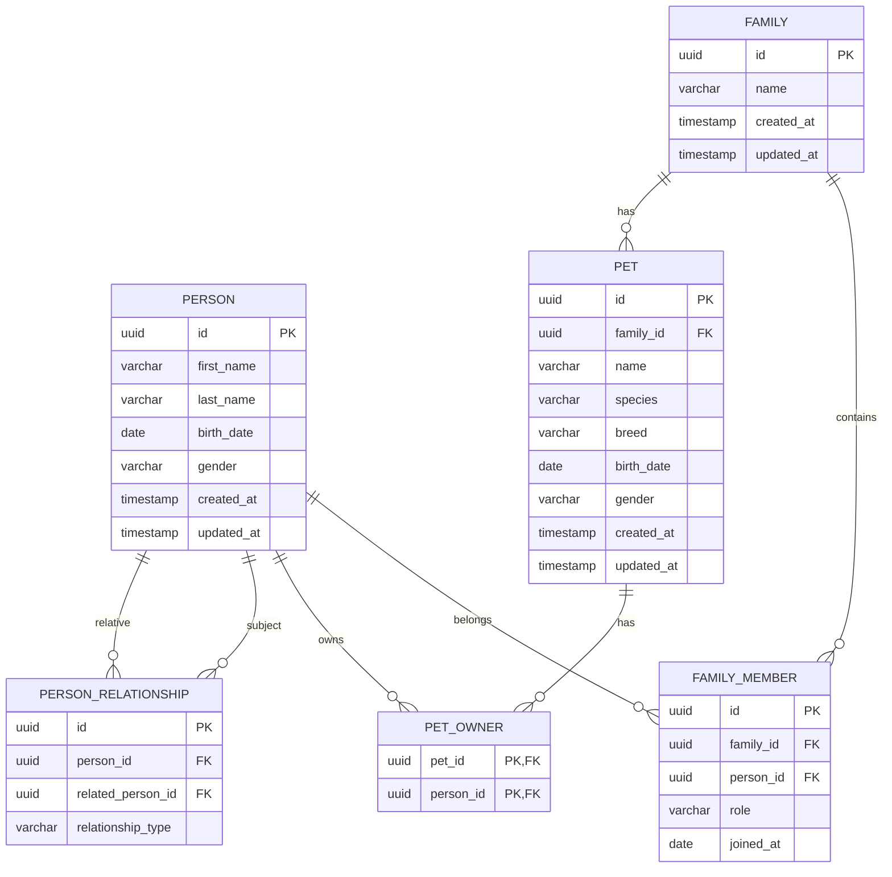

# ERD — модель данных семьи и домашних животных

## 1. Назначение

Модель предназначена для хранения информации о семьях, членах семьи, родственных отношениях и домашних животных.

**СУБД:** PostgreSQL  
**Тип идентификаторов:** UUID  
**Подход:** реляционная модель с нормализацией связей.

### Основные требования

- Хранение нескольких семей.
- Хранение персональных данных членов семьи.
- Возможность принадлежности человека нескольким семьям.
- Хранение ролей членов семьи.
- Поддержка родственных отношений между людьми.
- Хранение домашних животных.
- Возможность указать нескольких владельцев животного.

## 2. ERD-диаграмма



## 3. Описание сущностей

### 3.1. Family — семья

Таблица: `families`

| Поле | Тип | Описание |
|---|---|---|
| id | UUID | Первичный ключ |
| name | VARCHAR(255) | Название семьи |
| created_at | TIMESTAMPTZ | Дата создания |
| updated_at | TIMESTAMPTZ | Дата изменения |

**Связи:**
- Одна семья содержит множество членов семьи.
- Одна семья может содержать множество домашних животных.

### 3.2. Person — человек

Таблица: `persons`

| Поле | Тип | Описание |
|---|---|---|
| id | UUID | Первичный ключ |
| first_name | VARCHAR(100) | Имя |
| last_name | VARCHAR(100) | Фамилия |
| birth_date | DATE | Дата рождения |
| gender | VARCHAR(20) | Пол |
| created_at | TIMESTAMPTZ | Дата создания |
| updated_at | TIMESTAMPTZ | Дата изменения |

**Особенности:**
- Человек существует независимо от семьи.
- Один человек может принадлежать нескольким семьям.
- Родственные отношения определяются отдельной таблицей.

### 3.3. FamilyMember — член семьи

Таблица: `family_members`

| Поле | Тип | Описание |
|---|---|---|
| id | UUID | Первичный ключ |
| family_id | UUID | FK → families.id |
| person_id | UUID | FK → persons.id |
| role | VARCHAR(50) | Роль в семье |
| joined_at | DATE | Дата вступления |

Примеры ролей:
- `parent` — родитель
- `child` — ребёнок
- `guardian` — опекун
- `member` — участник

**Ограничение:** `UNIQUE(family_id, person_id)`.

Роль отражает положение человека внутри семейной группы, но не заменяет родственные отношения.

### 3.4. PersonRelationship — родственные отношения

Таблица: `person_relationships`

| Поле | Тип | Описание |
|---|---|---|
| id | UUID | Первичный ключ |
| person_id | UUID | FK → persons.id |
| related_person_id | UUID | FK → persons.id |
| relationship_type | VARCHAR(50) | Тип отношения |

Типы отношений:
- `parent` — родитель
- `spouse` — супруг
- `sibling` — брат или сестра
- `guardian` — опекун

**Правила:**
- Человек не может иметь отношение к самому себе.
- Для направленных отношений необходимо определить направление связи.
- Обратные отношения могут вычисляться программно.
- Для симметричных отношений необходимо исключать дублирование пар.

### 3.5. Pet — домашнее животное

Таблица: `pets`

| Поле | Тип | Описание |
|---|---|---|
| id | UUID | Первичный ключ |
| family_id | UUID | FK → families.id |
| name | VARCHAR(100) | Кличка |
| species | VARCHAR(100) | Вид животного |
| breed | VARCHAR(100) | Порода |
| birth_date | DATE | Дата рождения |
| gender | VARCHAR(20) | Пол |
| created_at | TIMESTAMPTZ | Дата создания |
| updated_at | TIMESTAMPTZ | Дата изменения |

Примеры видов:
- `cat` — кошка
- `dog` — собака
- `bird` — птица
- `rabbit` — кролик
- `other` — другое

Каждое животное принадлежит одной семье в текущей модели.

### 3.6. PetOwner — владелец животного

Таблица: `pet_owners`

| Поле | Тип | Описание |
|---|---|---|
| pet_id | UUID | FK → pets.id |
| person_id | UUID | FK → persons.id |

**Первичный ключ:** `(pet_id, person_id)`.

Позволяет:
- Назначать нескольких владельцев одному животному.
- Хранить несколько животных у одного человека.
- Разделять принадлежность животного семье и конкретным людям.

## 4. Кардинальности связей

| Связь | Кардинальность |
|---|---|
| Family → FamilyMember | 1:N |
| Person → FamilyMember | 1:N |
| Family → Pet | 1:N |
| Person ↔ Person | M:N через PersonRelationship |
| Person ↔ Pet | M:N через PetOwner |

## 5. Ограничения целостности

1. Все внешние ключи должны ссылаться на существующие записи.
2. Участник семьи не должен дублироваться в рамках одной семьи.
3. Владелец животного не должен дублироваться в `pet_owners`.
4. Человек не может быть родственником самого себя.
5. Дата рождения не должна находиться в будущем, если такое бизнес-правило требуется.
6. Удаление семьи и связанных данных должно регулироваться явно выбранной стратегией `ON DELETE`.
7. Если владельцами животного могут быть только члены его семьи, это правило необходимо проверять отдельно.

## 6. Рекомендуемые индексы

```sql
CREATE INDEX idx_family_members_person
    ON family_members(person_id);

CREATE INDEX idx_pets_family
    ON pets(family_id);

CREATE INDEX idx_pet_owners_person
    ON pet_owners(person_id);

CREATE INDEX idx_relationships_person
    ON person_relationships(person_id);

CREATE INDEX idx_relationships_related
    ON person_relationships(related_person_id);
```

Индексы по `family_members.family_id` и `pet_owners.pet_id` уже обеспечиваются левыми префиксами соответствующих уникального и первичного ключей.

## 7. Возможные расширения

### История членства

Добавить в `family_members`:

- `left_at` — дата выхода из семьи.

При необходимости хранить повторные периоды членства потребуется заменить уникальность `(family_id, person_id)` ограничением на отсутствие пересекающихся периодов.

### История владения животными

Добавить в `pet_owners`:

- `owned_from` — дата начала владения.
- `owned_until` — дата окончания владения.

### Справочники

При развитии системы выделить:

- `pet_species` — виды животных.
- `pet_breeds` — породы.
- `relationship_types` — типы родственных отношений.

### Медицинские данные животных

Возможные сущности:

- `pet_vaccinations` — вакцинации.
- `pet_medical_records` — медицинская история.
- `pet_visits` — посещения ветеринара.

## 8. Архитектурные замечания

**Family** представляет семейную группу или домохозяйство.

**Person** — самостоятельная сущность с собственной идентичностью, не зависящей от семьи.

**FamilyMember** — связь человека с семейной группой.

**PersonRelationship** — связь двух людей, определяющая родственные или юридические отношения.

**Pet** — домашнее животное, связанное с семьёй.

**PetOwner** — связь животного с конкретным человеком.

### Основные допущения MVP

- У животного одна текущая семья.
- Человек может принадлежать нескольким семьям.
- Родственные отношения существуют независимо от членства в семье.
- У животного может быть несколько владельцев.
- История изменений семейного состава и владения животными пока не хранится.

Такая модель подходит для MVP и допускает расширение без существенной переработки основных сущностей.

## 9. Реализация схемы (миграция 0002)

- Эта модель — отдельные семейные данные, не пользователи аутентификации и не ACL RAG.
- UUID генерируются PostgreSQL через `gen_random_uuid()`; расширения не требуются.
- Имена, названия, вид животного и связи обязательны. Даты рождения, пол и порода
  допускают NULL. `role` по умолчанию `member`, `joined_at` — текущая дата.
  Роли и виды животных остаются открытыми строковыми значениями.
- `parent`/`guardian`: `person_id` — родитель/опекун, `related_person_id` —
  ребёнок/подопечный. Обратные связи отдельно не создаются.
- Для `spouse`/`sibling` требуется `person_id < related_person_id` по UUID.
  Вызывающий код упорядочивает пару; CHECK и UNIQUE исключают обратные и прямые дубли.
  Типы отношений ограничены четырьмя значениями из ERD.
- Удаление человека каскадно удаляет его членства, родственные связи и записи
  владения, но сохраняет животных. Удаление животного удаляет записи владения.
  Удаление семьи удаляет членства, но блокируется, пока у семьи есть животные:
  сначала их нужно явно перенести или удалить. Люди сохраняются.
- `created_at`/`updated_at` — TIMESTAMPTZ; триггер обновляет `updated_at` при любом
  SQL UPDATE. Индексы соответствуют разделу 6.
- Запрет будущих дат рождения и требование членства владельца в семье животного
  не включены: в ERD это условные бизнес-правила. До появления API эти таблицы
  не предоставляют внешнего доступа; авторизация должна быть реализована отдельно.

## 10. Связь с учётной записью (миграция 0003)

`users.family_member_id` ссылается на `family_members.id` через UNIQUE FK
ON DELETE RESTRICT. Участник может не иметь аккаунта; manager/member обязательно
связаны с одним участником, admin может быть без связи. Семейная `role` не задаёт
системные привилегии. Подробности: [ADR 0006](0006-identity-family-access.md).
