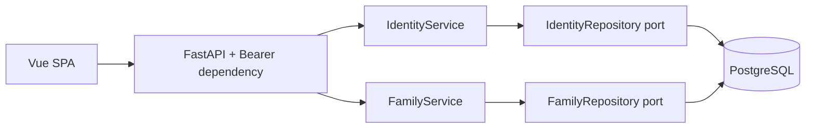

# ADR 0006: Учётные записи, сессии и доступ к семьям

## Контекст и решение

Добавляем DDD-модуль `identity`: доменные `User`, `Principal`, `UserRole`,
прикладной `IdentityService` с портами хранилища, паролей и токенов,
PostgreSQL-адаптер и HTTP API. Другие прикладные модули используют публичные
типы из `identity/application/contracts.py`. Модуль `families` получает свой
прикладной сервис, порт репозитория и API; доступ проверяется на сервере.

Миграция 0003 добавляет `users`, `user_sessions`, `login_attempts`, не меняя
существующие семейные таблицы. `users.family_member_id` — UNIQUE FK на
`family_members.id`, ON DELETE RESTRICT. Один пользователь связан максимум с
одним членством, одно членство — максимум с одной учётной записью. У admin связь
может отсутствовать; у manager/member обязательна (CHECK в PostgreSQL).
Системная роль не совпадает с семейной ролью parent/child/guardian/member.
Изменение семейной роли не повышает привилегии учётной записи.

## Матрица прав

| Операция | admin | manager | member |
|---|---|---|---|
| Список семей, состав | Все семьи | Только своя | Только своя |
| Создание и удаление семьи | Да | Нет | Нет |
| Переименование, добавление/роль/удаление участника | Любая семья | Только своя | Нет |
| Создание/изменение/отключение пользователя, сброс пароля | Да | Нет | Нет |
| Мониторинг /ready | Да | Нет | Нет |

Для неадминистратора фильтр по family_member_id применяется в SQL до возвращения
семейных данных. Чужая и отсутствующая семья одинаково дают 404. Мутации сначала
проверяют доступ; member_id проверяется внутри выбранной семьи. Создание участника
создаёт отдельного Person; произвольная привязка существующего человека через UUID
не предоставляется, чтобы не открыть доступ к людям других семей.
Удаление членства с учётной записью и семьи с такими членствами блокируется FK;
нужно сначала перепривязать пользователя. Отключение пользователя не удаляет связь.
Люди при удалении членства сохраняются согласно ADR 0004. Семьи с животными также
не удаляются. Пользователи отключаются, физического удаления через API нет.

Это семейная область доступа MVP, а не реализация tenant/ACL для будущего RAG.
Глобальный admin намеренно имеет доступ ко всем семьям. В модели Person может
иметь несколько членств, но текущая учётная запись предоставляет доступ только
к одной семье. Поддержка нескольких семей на аккаунт потребует отдельной модели.

## Пароли и сессии

- Используем стандартный hashlib.scrypt: N=2^17, r=8, p=1, случайная соль 16 байт,
  результат 32 байта. Формат `scrypt$salt$hash`; пароль в БД не хранится.
  Эти параметры соответствуют [OWASP Password Storage Cheat Sheet](https://cheatsheetseries.owasp.org/cheatsheets/Password_Storage_Cheat_Sheet.html).
  Реализация — [hashlib Python](https://docs.python.org/3.12/library/hashlib.html#hashlib.scrypt).
- Пароль создания/сброса: 12–128 символов; отсутствующий пользователь тоже проходит
  дорогую проверку. Вычисления выполняются в потоке, максимум два одновременно
  на процесс; отмена запроса не освобождает слот до окончания вычисления.
- Токен — 32 случайных байта в URL-safe представлении. В БД только SHA-256 токена,
  user_id и expires_at (8 часов). Состояние и права пользователя перечитываются.
- Logout удаляет сессию; любое изменение пользователя отзывает все его сессии,
  включая смену пароля, роли, членства или активности. Истёкшие сессии удаляются
  при успешном входе. Отдельного refresh token нет.
- SQL upsert ограничивает вход 10 попытками за минуту на хеш socket peer IP.
  Счётчик коммитится отдельно и сохраняется при неудачном входе. X-Forwarded-For
  не доверяем. За Nginx пользователи разделяют лимит адреса прокси: это консервативное
  ограничение локального MVP. Перед внешней эксплуатацией нужен доверенный proxy
  policy и отдельные лимиты; текущая схема не заявляется готовой для Интернета.
- Токен хранится только в памяти Pinia, без cookies/localStorage. Обновление вкладки
  требует входа; cookies отсутствуют, запросы требуют явный Bearer заголовок.
  Использовать TLS при внешнем доступе. UI и API не возвращают хеши и пароли;
  ошибки валидации исключают input/context, все ответы имеют Cache-Control: no-store.
- Стандартный .env Basic остаётся только для /ready и smoke test, не предоставляет
  доступ к пользователям или семьям. Web Admin использует единый вход БД для всех
  страниц. Bootstrap — явная команда, не автоматический импорт при старте.
- Последний активный администратор защищён от отключения/понижения роли;
  PostgreSQL advisory transaction lock сериализует такие изменения.

## Транзакции и ограничения

HTTP-зависимость открывает сессию и транзакцию на запрос; ошибки откатывают изменения.
Хранилища SQLAlchemy реализуют прикладные порты. Связь identity с families реализована
FK в общей БД модульного монолита; identity не импортирует чужие ORM-таблицы.
Application/domain не импортируют FastAPI или SQLAlchemy.

Новые backend зависимости не нужны. `@vue/test-utils` и `jsdom` добавлены только
как dev-зависимости для тестов настоящих форм, пустых состояний и ошибок API.
Визуальная проверка браузером не заменяется компонентными тестами.
Существующие frontend зависимости требуют отдельного обновления: при установке
npm сообщил о 8 audit findings (3 moderate, 3 high, 2 critical); `audit fix --force`
не выполнялся, поскольку может несовместимо обновить стек.

Аудит административных действий, MFA, self-service reset, invitation/registration,
управление животными и история семейных изменений в этот срез не входят.

Механизм сессий этого ADR заменён JWT и Pinia + localStorage в
[ADR 0007](0007-jwt-pinia.md). Матрица прав и связь с членом семьи сохранены.
