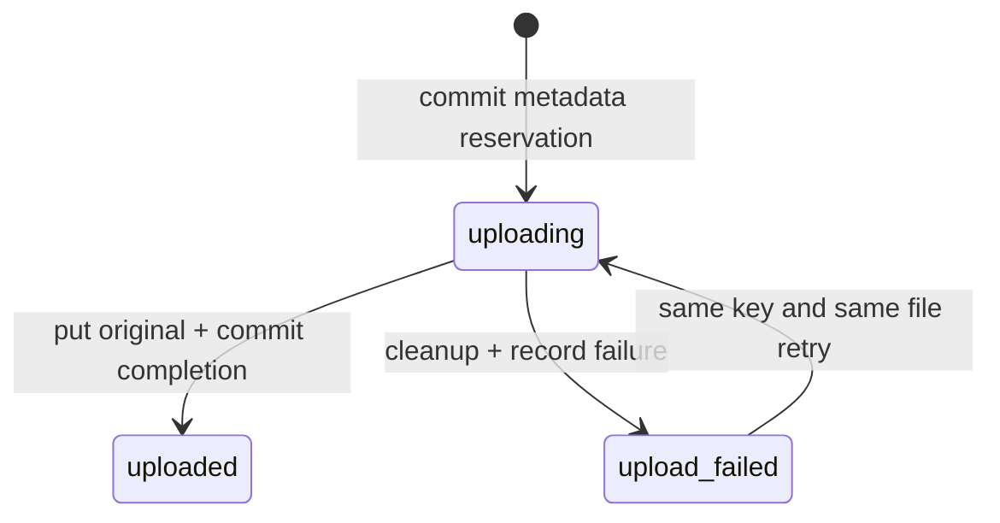

# ADR 0008: Загрузка оригиналов документов для RAG

## Граница среза

Добавлен DDD-модуль `documents`: загрузка PDF/DOCX/HTML, хранение оригинала,
метаданных, области доступа и состояния операции. Это **не индексация**: очередь
извлечения/чанкинга/эмбеддингов, Qdrant и поиск к документам ещё не подключены.
`uploaded` означает «оригинал сохранён», а не «готов к ответам RAG»; UI сообщает это.
Пустые worker-задачи и фиктивные статусы ready не добавляются.

```text
modules/documents/
  domain/entities.py           # Document, Visibility, DocumentStatus, file policy
  application/upload.py        # UploadDocument, ListDocuments, repository/storage/access ports
  infrastructure/repository.py     # PostgreSQL, короткие самостоятельные транзакции
  infrastructure/object_storage.py # MinIO/S3, SDK в потоках
  api/routes.py               # ограниченное чтение тела, HTTP DTO и статусы
api/document_dependencies.py  # composition, публичный FamilyService, короткие DB read scopes
web-admin/src/views/Documents.vue # загрузка, ACL, список, ошибки, пагинация
```

Domain/application используют стандартную библиотеку и публичные контракты identity,
не зависят от FastAPI, SQLAlchemy и SDK. Архитектурный тест дополнен boto3/botocore.
Новая зависимость Boto3 1.40.76 нужна для стандартного S3-подписывания и MinIO API;
SDK и транзитивные версии зафиксированы в uv.lock. Новых сервисов нет.

## Авторизация и метаданные

У документа обязательны family_id, owner_id, имя, MIME, размер, SHA-256,
сгенерированный object_key, visibility, status, created_at и необязательный error_code.
Миграция 0005 создаёт таблицу documents, FK, CHECK и индексы. Удаление семьи или
пользователя с документами блокируется RESTRICT: оригиналы не остаются без владельца.
Исходное имя не используется как путь и не возвращается в теле ошибок хранилища.
Object key не включён в REST DTO, публичные URL и bucket policy не создаются.

Существующий контекст приложения — семья. family_id выступает областью доступа этого
среза; это не реализация enterprise tenant_id или document ACL для будущего retrieval.

- admin загружает в любую существующую семью и видит все её документы;
- manager загружает только в свою семью;
- member только просматривает доступные метаданные своей семьи;
- private (по умолчанию): только владелец и глобальный admin;
- family: все авторизованные участники выбранной семьи и admin;
- владелец, утративший доступ к семье, не получает обход этого ограничения;
- чужая и отсутствующая семья возвращают одинаковый 404 до чтения файла.

FamilyService используется как публичный прикладной контракт доступа. Запрос списка
сначала проверяет семью, затем PostgreSQL фильтрует visibility/owner_id до возврата
строк. Новая проверка доступа выполняется и в UploadDocument, независимо от API.
SQLAlchemy-соединение аутентификации не удерживается на время приёма файла и S3 I/O:
это исключает исчерпание пула транзакциями, ожидающими собственный дополнительный
connection. В каждый момент выполняются максимум две загрузки на процесс.

## HTTP и файловая политика

POST /documents принимает **одно бинарное тело**, параметры family_id/filename/
visibility и UUID-заголовок Idempotency-Key. Multipart не используется: можно
проверить JWT и права до чтения тела и ограничить поток без промежуточного парсинга
большой формы. Web UI отправляет выбранный File напрямую; Swagger описывает binary
requestBody. Клиент не задаёт пути и object key.

Лимит 10 MiB проверяется по Content-Length, по фактически прочитанным байтам и ещё
раз в доменной политике. Чтение ограничено 30 секундами; ожидание свободного слота —
3 секундами (429 при перегрузке). Nginx также имеет client_max_body_size 10m.
SDK имеет connect/read timeouts 3/10 секунд, максимум две попытки на запрос;
вызовы выполняются через asyncio.to_thread. Отмена ожидает окончания native I/O,
чтобы очистка не соревновалась с незавершившимся put_object.

Проверяются пустота, длина/управляющие символы/разделители пути в имени, расширение,
заявленный MIME и сигнатура/контейнер. PDF — версия заголовка и EOF; HTML — UTF-8,
HTML-маркер и отсутствие NUL; DOCX — ZIP-контейнер с обязательными частями.
Для DOCX ограничены центральный каталог, число элементов (1000), суммарный заявленный
распакованный размер (50 MiB), compression ratio (200), запрещены traversal,
символические ссылки, дубли и зашифрованные элементы. Архив не извлекается на диск.
Это проверка типа/контейнера, не полный PDF/XML parser и не антивирус.
HTML и инструкции внутри документов — недоверенные данные: они не исполняются,
не отображаются через v-html и не передаются модели в этом срезе.

## Состояния, идемпотентность и сбои



UUID документа детерминирован по owner_id и Idempotency-Key. Резервирование коммитится
до S3 I/O; ON CONFLICT и row lock сериализуют конкурирующие запросы.
Повтор uploaded возвращает прежнюю запись без повторного put_object. Другая семья,
имя, MIME, checksum или visibility с тем же ключом дают 409. Параллельная загрузка с
тем же ключом также даёт 409, не создавая второй оригинал.

При ошибке SDK или фиксации completion use case пытается удалить объект и сохранить
upload_failed. Успешная очистка означает storage_unavailable; неудачная —
cleanup_required. Детали SDK/SQL и содержимое файла клиенту не возвращаются.
Failed-запись можно повторно загрузить с тем же ключом и файлом. UI сохраняет ключ
для повторного нажатия, пока файл/семья/доступ не изменены. После перезагрузки страницы
ключ не сохраняется: новая отправка создаёт другую операцию.

Между PostgreSQL и S3 нет общей транзакции. Жёсткое завершение процесса или полный
отказ БД может оставить uploading; автоматический reclaim такой операции не
реализован, чтобы не допустить гонки с ещё работающим загрузчиком. Оператор должен
сверить строку с object key. Состояние не выдаётся за успешную индексацию.
Cleanup_required тоже требует сверки хранилища. Это ограничение явно сохранено,
а не скрыто фиктивной очередью или обещанием exactly-once.

## Конфигурация

DOCUMENTS_BUCKET по умолчанию rag-documents. Bucket создаётся лениво при первой
загрузке и не делается публичным. Для Docker local API получает MinIO credentials
из существующих MINIO_ROOT_USER/MINIO_ROOT_PASSWORD через MINIO_ACCESS_KEY/
MINIO_SECRET_KEY. Это локальное упрощение: для внешней среды нужны отдельные ключи
с правами только на bucket; root-ключ не должен использоваться как production policy.
Bucket не является новым компонентом инфраструктуры. Миграции и named volumes сохраняются.

## TDD

1. Сначала написан tests/unit/test_document_upload.py. Первый запуск дал ожидаемый
   ModuleNotFoundError app.modules.documents (red); реализации ещё не было.
2. После реализации первый green дал 13 passed. Затем добавлены тесты DOCX,
   недоверенного HTML, cancellation и отказа commit с компенсацией.
3. Тесты web-admin/tests/documents.test.ts созданы до Documents.vue. Первый запуск
   упал на отсутствующем компоненте (red), после реализации — green.
4. Добавлены PostgreSQL API-тесты для private/family ACL, чужой семьи, read-only
   участника, MIME/размера, повторов, конкурентного запроса, ошибки и повтора загрузки.
5. Live MinIO тесты проверяют SDK put/get/delete и полный API → metadata → original
   путь с точным сравнением байтов. Все данные синтетические, без LLM.

API не предоставляет скачивание, удаление, замену, полную ingestion/retry queue или
изменение ACL уже созданного документа. UI не показывает такие действия работающими.
Эти use cases требуют отдельного среза с очисткой индекса и проверками доступа.

## Результат проверки

- Ruff lint/format и strict mypy (57 source files): passed.
- Python pytest с TEST_OBJECT_STORAGE=1: 55 passed, 1 skipped. Пропущен только
  Compose CLI-тест внутри контейнера; отдельно на хосте он прошёл.
- Live MinIO contract и API → PostgreSQL → MinIO E2E: passed; байты оригинала
  сравнены с синтетическим fixture, тестовые строки и объекты очищены.
- Frontend: 27 тестов passed; TypeScript и Vite build passed, включая Docker build.
- Миграция 0005 применена. Обновлённые API/worker/Web Admin — healthy.
- Через Nginx /documents 200, список без JWT 401, upload OpenAPI contract корректен,
  аутентифицированный /ready 200.
- Визуальный браузерный E2E не выполнялся: браузерный инструмент недоступен.
