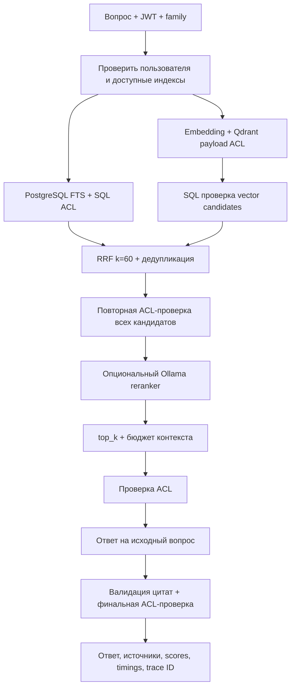

# Advanced RAG

Реализован один модуль RAG в modular monolith: PostgreSQL FTS, векторный поиск
Qdrant, Reciprocal Rank Fusion, опциональный локальный LLM-reranker, grounded
ответ с цитатами. Это reference implementation без заявленного прироста качества.

Диаграмма показывает hybrid /ask. В keyword/vector fusion и reranker пропускаются.
В /search пропускаются chat, reranker и Query Rewriting. При пустой выдаче /ask
допускает одну rewrite-попытку с повторным ACL scope; после второго пустого поиска
возвращается явный отказ. Пустой scope не отправляется модели.

| Этап | Реализация | Ограничения |
| --- | --- | --- |
| FTS | SqlEvidenceRepository.keyword | simple/russian GIN, AND, русский single-word prefix |
| Vector | QdrantSearch + read_candidates | совместимая модель/digest/dimensions, family/document/generation filters |
| Fusion | domain/ranking.py | равные веса, k=60, max 24 candidates, UUID tie-break |
| Reranker | application port + OllamaReranker | /ask hybrid, 10 секунд, 600 символов на passage, только перестановка |
| Grounding | AnswerQuestion + OllamaChat | исходный вопрос, max 6000 символов evidence, номера цитат |
| Observability | RagMeasurements + Prometheus | фиксированные labels, без текста/идентификаторов документов |

Если reranker не отвечает или возвращает невалидный порядок, сохраняется RRF.
Поле reranked показывает успешное применение; score остаётся RRF даже после
перестановки. Семантическую верность rewrite/reranker и ответа форматная проверка
не доказывает. Модель не является механизмом ACL. Подробные решения и tradeoffs:
[ADR 0023](../adr/0023-advanced-rag.md), [API](../api/rag.md).

Сравнивать нужно keyword, vector, hybrid RRF (RAG_RERANKING=false) и hybrid с reranker
на одной версии golden dataset, с одинаковыми model IDs, top_k, ACL scope и hardware.
Метрики: Recall@K, MRR, цитаты, faithfulness, abstention, p50/p95 latency. Таких
сравнительных измерений пока нет; unit/integration/smoke подтверждают работоспособность.
