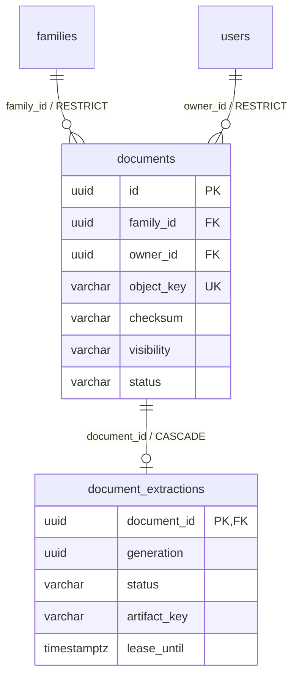
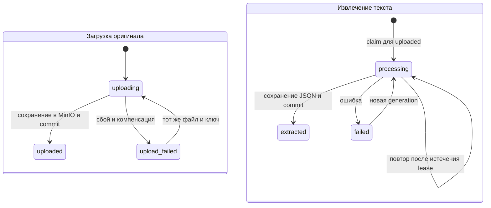

# Модель хранения метаданных документов

Документ описывает реализованную модель модуля `documents`: PostgreSQL хранит
метаданные и состояния, MinIO — оригиналы файлов и извлечённый текст.
Основание — миграции [0005](../../migrations/versions/0005_documents.py) и
[0006](../../migrations/versions/0006_document_extractions.py), доменные сущности
и текущие application/infrastructure-сценарии. Это описание кода, а не подтверждение
применения миграций к конкретной базе.

`uploaded` означает сохранение оригинала, `extracted` — извлечение текста.
Ни одно из этих состояний не означает готовность документа к RAG-поиску.
Каталог чанков и векторный индекс описаны ниже; поискового API пока нет.

## Связи и ответственность хранилищ

Один документ принадлежит одной семье и одному владельцу — учётной записи `users`.
У документа может не быть записи извлечения, либо есть одна запись текущей попытки.
История попыток отдельными строками не сохраняется.

PostgreSQL — источник состояния и прав доступа. MinIO хранит байты в bucket из
`DOCUMENTS_BUCKET` (по умолчанию `rag-documents`). Ключи объектов — ссылки внутри
этого bucket, а не публичные URL. Оригиналы и текст не хранятся в SQL-колонках.

## Таблица `documents`

| Поле | Тип PostgreSQL | NULL | Значение и правила |
| --- | --- | --- | --- |
| `id` | UUID | нет | PK. Формируется приложением детерминированно из владельца и ключа идемпотентности. Серверного default нет. |
| `family_id` | UUID | нет | FK → `families.id`, `ON DELETE RESTRICT`. Область доступа документа. |
| `owner_id` | UUID | нет | FK → `users.id`, `ON DELETE RESTRICT`. Автор загрузки, задаётся из аутентифицированного пользователя. |
| `filename` | VARCHAR(255) | нет | Исходное имя без пути; безопасное имя проверяет приложение. |
| `content_type` | VARCHAR(100) | нет | Нормализованный MIME после проверки файла. |
| `size_bytes` | INTEGER | нет | Размер оригинала в байтах, CHECK: `> 0 AND <= 10485760` (10 MiB). |
| `checksum` | VARCHAR(64) | нет | SHA-256 оригинальных байтов, lowercase hex; вычисляется приложением. |
| `object_key` | VARCHAR(255) | нет | UNIQUE. Ключ оригинала: `originals/{family_id}/{id}`. |
| `visibility` | VARCHAR(20) | нет | CHECK: `private` или `family`. |
| `status` | VARCHAR(30) | нет | CHECK: `uploading`, `uploaded`, `upload_failed`. |
| `error_code` | VARCHAR(50) | да | Код последнего сбоя загрузки; при успехе/повторном резервировании очищается. |
| `created_at` | TIMESTAMPTZ | нет | Default БД: `now()`. Время создания строки, сохраняется при повторе. |

Кроме `created_at`, у колонок нет серверных значений по умолчанию. В HTTP API
`visibility` по умолчанию `private`, а доменная сущность начинает с `uploading`;
это defaults приложения, не DDL.

Индексы: PK по `id`, UNIQUE по `object_key`,
`idx_documents_family_created (family_id, created_at)` и
`idx_documents_owner (owner_id)`. Список сортируется по `created_at DESC, id`.
Checksum не уникален и не индексирован: одинаковые байты могут принадлежать
разным документам и областям доступа.

Приложение проверяет расширение, MIME и содержимое для PDF, DOCX, HTML/HTM,
а также запрещает пустые имена, управляющие символы и разделители путей.
`application/octet-stream` разрешён как заявленный тип при распознанном формате;
в БД сохраняется конкретный MIME. Эти проверки, формат SHA-256 и шаблон object key
не закреплены CHECK-ограничениями БД. FK также не доказывает, что владелец имеет
доступ к выбранной семье: это проверяет application-слой.

## Таблица `document_extractions`

| Поле | Тип PostgreSQL | NULL | Значение и правила |
| --- | --- | --- | --- |
| `document_id` | UUID | нет | PK и FK → `documents.id`, `ON DELETE CASCADE`. Не более одной строки на документ. |
| `generation` | UUID | нет | UUIDv4 текущей попытки; меняется при повторной обработке. Не отдельный PK и не UNIQUE. |
| `status` | VARCHAR(20) | нет | CHECK: `processing`, `extracted`, `failed`. |
| `page_count` | INTEGER | нет | Default `0`, CHECK: от 0 до 200 включительно. |
| `character_count` | INTEGER | нет | Default `0`, CHECK: `>= 0`. Число символов нормализованного текста, не байтов и не токенов. |
| `error_code` | VARCHAR(50) | да | Код сбоя извлечения/хранения. |
| `artifact_key` | VARCHAR(255) | да | Ключ JSON в MinIO: `extracted/{document_id}/{generation}.json`. Записывается при завершении. |
| `lease_until` | TIMESTAMPTZ | нет | Срок блокировки попытки; при claim приложение задаёт `now() + interval '5 minutes'`. |
| `updated_at` | TIMESTAMPTZ | нет | Default `now()`; при переходах обновляется явно репозиторием, триггера нет. |

Дополнительных индексов, кроме PK, миграция не создаёт. Поля `lease_until` и
`updated_at` относятся к persistence-модели и не входят в доменную `Extraction`.
БД не связывает CHECK-условием `extracted` с обязательным `artifact_key` или
ненулевыми счётчиками: согласованность обеспечивает сценарий извлечения.

## Состояния и идемпотентность

Статусы двух таблиц независимы: ошибка извлечения оставляет оригинал `uploaded`.
Для извлечения нужен сохранённый оригинал и зарегистрированный extractor;
сейчас доступен PDF.

UUID загрузки вычисляется как
`uuid5(NAMESPACE_URL, f"rag-upload:{actor.id}:{idempotency_key}")`.
Сам `Idempotency-Key` отдельной колонкой не хранится. Резервирование использует
`ON CONFLICT` и блокировку строки. С тем же ключом проверяются семья, владелец,
имя, MIME, checksum и visibility. Успешный повтор возвращает прежний документ,
`upload_failed` разрешает повтор, активный `uploading` или несовпадающие данные
дают conflict. Новый ключ создаёт другую операцию даже для одинакового содержимого.

Claim извлечения также блокирует строку. Готовый `extracted` возвращается без
повторной обработки; `processing` с действующим lease даёт conflict.
После `failed` или истечения lease создаётся новая `generation`, счётчики,
ошибка и ссылка на артефакт сбрасываются. Завершение и запись ошибки проверяют
`document_id`, `generation` и статус `processing`, чтобы устаревшая попытка
не перезаписала результат новой. Истечение lease само по себе не запускает retry:
нужен новый вызов сценария.

## Артефакт извлечённого текста

JSON хранится в том же bucket с MIME `application/json`. Структура:

| Поле JSON | Значение |
| --- | --- |
| `schema_version` | Сейчас `1`, версия формата артефакта. |
| `document_id` | UUID документа строкой. |
| `generation` | UUID попытки строкой. |
| `source_checksum` | SHA-256 оригинала из `documents.checksum`. |
| `extractor` | Имя реализации extractor. |
| `pages` | Массив `{ "page_number": 1, "text": "…" }`; нумерация последовательная с 1. |

До извлечения приложение сверяет SHA-256 оригинала с БД. При чтении артефакта
проверяются версия, документ, generation, checksum и совпадение счётчиков с БД.
Ограничения приложения: максимум 200 страниц, 2 MiB суммарного UTF-8 текста и
6 MiB JSON-артефакта. `character_count` равен сумме Python `len(page.text)` после
нормализации NFC, переводов строк и удаления управляющих символов.
Содержимое страниц считается недоверенными данными.

## Доступ и HTTP-представления

`family_id` — текущая область авторизации; отдельного `tenant_id`, таблицы ACL
или списка разрешённых пользователей у документов нет. Не следует приравнивать
эту модель к реализованной универсальной мультитенантности.

Приложение сначала проверяет доступ к семье. Admin имеет глобальный доступ;
для остальных пользователей дополнительно действует условие
`owner_id == actor.id OR visibility == 'family'`. Поэтому менеджер семьи
не получает доступ к чужим `private` только благодаря своей роли. Загрузка разрешена любой авторизованной роли при доступе к семье. Владельцу
разрешена обработка своего документа; обработка чужого требует управления семьёй
и видимости документа. См. [ADR 0014](../adr/0014-member-document-upload.md).

Репозиторный `get_visible` применяет owner/visibility-фильтр, но сам не проверяет
членство в семье. Сценарии извлечения, статуса и чтения страниц дополняют его
проверкой семьи перед чтением содержимого MinIO. Прямой вызов репозитория не
заменяет application-авторизацию. PostgreSQL RLS этой моделью не реализован.

`DocumentView` возвращает поля документа кроме `object_key`.
`ExtractionView` возвращает `document_id`, `generation`, `status`, `page_count`,
`character_count`, `error_code`; ключ артефакта и lease не раскрываются.
Постраничный текст доступен через отдельный авторизованный endpoint.
HTTP-контракты определены в [routes.py](../../src/app/modules/documents/api/routes.py),
загрузка описана в [API guide](../api/document-upload.md).

## Согласованность, удаление и ограничения

Между PostgreSQL и MinIO нет общей транзакции. Загрузка сначала фиксирует
`uploading`, затем сохраняет объект, затем фиксирует `uploaded`. При сбое сценарий
пытается удалить объект и записать `upload_failed`. Коды загрузки:
`storage_unavailable` и `cleanup_required` при неудачной очистке.

Извлечение сначала фиксирует claim, затем записывает JSON и завершает строку.
Сбой приводит к попытке удаления JSON и записи `failed`. Возможны ошибки PDF,
`source_checksum_mismatch`, `text_limit`, `extraction_unavailable`;
неудачная очистка даёт `cleanup_required`. `error_code` — строка, не SQL ENUM,
поэтому допустимые коды определяются реализацией.

Падение процесса или отказ БД может оставить незавершённую строку либо объект
без подтверждённого состояния. Для загрузки автоматического reclaim нет;
для извлечения доступен новый claim после lease. `generation` защищает состояние
БД, но не гарантирует отсутствие осиротевших объектов в MinIO.

Удаление семьи/владельца с документами блокируется FK `RESTRICT`. Удаление строки
документа каскадно удаляет только строку извлечения. SQL FK не удаляют оригинал
и JSON из MinIO. Пользовательские сценарии удаления, замены, изменения ACL,
история версий и автоматическая очистка объектов пока не реализованы.
Не предусмотрены `updated_at` для документа, дата завершения загрузки,
отдельный журнал попыток, конфигурация чанкинга,
модель/размерность эмбеддингов и состояние индекса. Их добавление требует
отдельного проектирования и миграций.

## Где находится реализация

- [domain/entities.py](../../src/app/modules/documents/domain/entities.py): Document, статусы, видимость и проверка файла.
- [domain/extraction.py](../../src/app/modules/documents/domain/extraction.py): Extraction, страницы и лимиты текста.
- [application/upload.py](../../src/app/modules/documents/application/upload.py): загрузка, идемпотентность и порты.
- [application/extraction.py](../../src/app/modules/documents/application/extraction.py): извлечение и чтение артефакта.
- [infrastructure/repository.py](../../src/app/modules/documents/infrastructure/repository.py): SQL документов.
- [infrastructure/extraction_repository.py](../../src/app/modules/documents/infrastructure/extraction_repository.py): claim, lease и generation.
- [ADR 0008](../adr/0008-document-upload.md): решения по загрузке и компенсации.
- [ADR 0009](../adr/0009-upload-preparation.md): автоматический запуск подготовки из формы.

## Доменные операции и адаптеры

Сущности неизменяемы. `Document.complete_upload()`, `fail_upload(code)` и
`retry_upload()` возвращают новый снимок с допустимым состоянием. `Extraction`
предоставляет `complete(page_count, character_count, artifact_key)` и `fail(code)`.
Завершение извлечения проверяет наличие результата: 1–200 страниц, положительный
счётчик символов и непустой ключ до 255 символов. Коды ошибок ограничены 1–50
символами. Это проверки методов, а не дополнительные CHECK БД или универсальная
валидация конструктора сущности.

SQL-адаптеры используют эти методы и сохраняют защитные условия статусов и generation
в UPDATE. Для загрузки запись ошибки допускается только пока строка uploading;
запоздалый сбой не перезаписывает uploaded. Подробности: [ADR 0010](../adr/0010-document-domain-lifecycle.md).

## Очередь обработки (миграция 0007)

`document_processing_jobs` хранит одно текущее задание на документ. FK `document_id`
→ documents.id с ON DELETE CASCADE, `requested_by` → users.id с RESTRICT.
Задание queued создаётся атомарно при завершении загрузки PDF. Отдельная задача
очереди не равна состоянию оригинала или извлечения.

| Поле | Тип | NULL / default | Назначение |
| --- | --- | --- | --- |
| document_id | UUID | NOT NULL, PK | Документ. |
| requested_by | UUID | NOT NULL | Пользователь, чьи актуальные права проверяет worker. |
| generation | UUID | NOT NULL | Токен текущей попытки для conditional UPDATE. |
| status | VARCHAR(20) | NOT NULL | CHECK: queued, processing, retry_wait, succeeded, failed. |
| attempts | INTEGER | NOT NULL, 0 | CHECK: 0–3. Счётчик текущего цикла повторов. |
| error_code | VARCHAR(50) | NULL | Последняя безопасная категория ошибки. |
| available_at | TIMESTAMPTZ | NOT NULL, now() | Когда разрешён следующий claim. |
| lease_until | TIMESTAMPTZ | NULL | Lease 10 минут после claim; очищается при завершении. |
| created_at | TIMESTAMPTZ | NOT NULL, now() | Время создания; сохраняется при явном retry. |
| started_at | TIMESTAMPTZ | NULL | Начало последней попытки. |
| finished_at | TIMESTAMPTZ | NULL | Завершение terminal state. |

Индекс idx_processing_available по (status, available_at); PK исключает дубли.
Failed job можно явно вернуть в queued с обнулением attempts и новым generation.
История попыток отсутствует. Текст задания хранится в MinIO, payload очереди
содержимое не дублирует. Подробности: [ADR 0011](../adr/0011-processing-queue-monitoring.md).

## Каталог чанков и индекса (0008–0009)

Миграция 0008 добавляет две таблицы:

| Таблица | Поля | Ограничения и назначение |
| --- | --- | --- |
| document_indexes | document_id UUID PK/FK → documents.id CASCADE; generation UUID; fingerprint VARCHAR(64); source_checksum VARCHAR(64); extraction_generation UUID | Один текущий каталог на документ; generation/fingerprint фиксируют происхождение. |
| document_indexes | status VARCHAR(20); collection_name VARCHAR(100); embedding_model VARCHAR(200); embedding_digest VARCHAR(128); dimensions INTEGER | Status: indexing/indexed/failed, dimensions > 0; все поля NOT NULL. |
| document_indexes | chunker_version VARCHAR(50); chunk_size/overlap/count INTEGER | NOT NULL; size > 0, 0 <= overlap < size, count >= 0, default count=0. |
| document_indexes | error_code VARCHAR(50); indexed_at TIMESTAMPTZ | Nullable. Ставятся при завершении/ошибке; готовность проверяется по indexed. |
| document_chunks | id UUID PK; document_id UUID FK → documents.id CASCADE; index_generation UUID | NOT NULL. Generation связывает строки с актуальным каталогом на уровне приложения. |
| document_chunks | ordinal INTEGER; page_number INTEGER; start_offset/end_offset INTEGER; text TEXT | NOT NULL; ordinal >= 0, page >= 1, 0 <= start < end. UNIQUE(document_id, ordinal). |
| document_chunks | search_vector TSVECTOR | Generated stored: to_tsvector('simple', text); GIN idx_chunks_search. |

Индекс idx_chunks_document_generation по (document_id, index_generation).
Для времён/nullable полей, кроме chunk_count, серверные defaults не заданы.
Полный набор NOT NULL и CHECK задаётся миграцией 0008; схемы не хранят историю
версий и числовые embedding vectors — последние хранятся в Qdrant.

Миграция 0009 добавляет document_processing_jobs.reindex_requested BOOLEAN NOT NULL
DEFAULT false. Явная переиндексация terminal job выставляет true; active task
не сбрасывается. Поле сохраняется при retry.

Статус original uploaded, extraction extracted, job succeeded и index indexed —
разные состояния. Для нового pipeline succeeded выставляется после индекса;
старые succeeded могут относиться только к извлечению текста. Для них вызовите reindex.
Очистка SQL через CASCADE сама не удаляет Qdrant points: пользовательский delete
по-прежнему требует отдельного согласованного сценария. Частичный/failed index
нельзя использовать для retrieval без проверки active generation.
См. [ADR 0012](../adr/0012-chunking-embeddings.md).

### Проверка одинаковых оригиналов

Миграция 0010 добавляет индекс `idx_documents_owner_checksum` по `(owner_id, checksum)`.
`reserve` использует transaction advisory lock для атомарной проверки одинаковых
байтов владельца, включая параллельные запросы. Старые строки сохраняются;
уникальное SQL-ограничение не вводится. Политика и ограничения описаны в
[ADR 0015](../adr/0015-document-content-deduplication.md).
